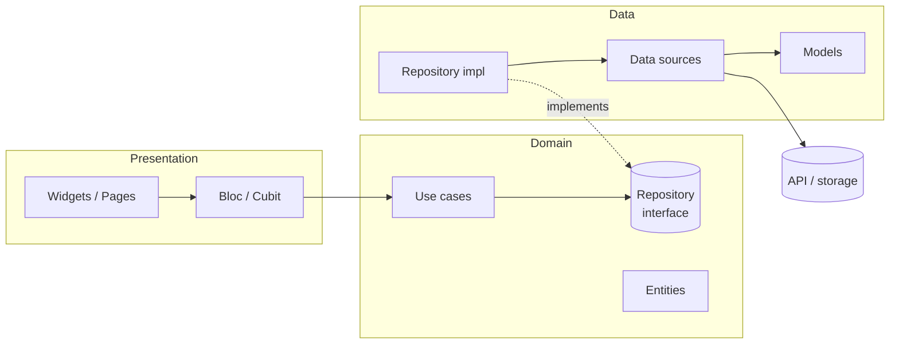

# Flutter Clean Starter

[](https://flutter.dev)
[](https://dart.dev)
[](https://github.com/MohamedRai/flutter-clean-starter/actions/workflows/ci.yml)
[](LICENSE)
[](https://pub.dev/packages/very_good_analysis)

A production-grade Flutter starter for Android and iOS: strict Clean
Architecture, Bloc, go_router, injectable, three flavors, three languages
(incl. RTL), code-generation bricks and a ready-to-use Claude Code setup.
Clone it, rename it, delete the example, build your app.

## Features

- **Clean Architecture** — `domain` / `data` / `presentation` per feature,
  enforced dependency rule, documented in [docs/architecture.md](docs/architecture.md).
- **Reusable core** — `Result<T>` error type, failure hierarchy,
  `BaseRepository` with 5 fetch policies (incl. stale-while-revalidate),
  single-flight caching, paginated cache, `AsyncCubit`, `PagingCubit`.
- **Networking** — Dio factory with auth, logging, retry and error-mapping
  interceptors; status-code → exception mapping; connectivity check.
- **3 flavors** — dev / staging / prod with their own app id, name and env
  file (`--dart-define-from-file`), Android product flavors + iOS schemes.
- **Routing** — go_router with type-safe routes, bottom-nav shell
  (`StatefulShellRoute`), auth guard, 404 page, deep links.
- **Localization** — English, French, Arabic (RTL) via `gen-l10n`.
- **Theming** — Material 3 light/dark from design tokens.
- **Global error handling** — `FlutterError.onError`,
  `PlatformDispatcher.onError`, `runZonedGuarded`, `AppBlocObserver`.
- **Example feature** — posts (JSONPlaceholder): list + detail,
  pull-to-refresh, offline fallback, Bloc **and** Cubit styles, full tests.
  Removable with one command.
- **8 mason bricks** — feature, usecase, bloc, cubit, repository,
  datasource, page, model — all generating code that passes analyze.
- **Quality** — very_good_analysis (0 issues), 100+ tests, coverage gate,
  GitHub Actions CI, Makefile + PowerShell scripts.
- **Claude Code ready** — `CLAUDE.md`, 9 skills, 7 agents, auto-format hook.

## Tech stack

| Package | Purpose |
|---|---|
| flutter_bloc, bloc, bloc_concurrency | State management, event concurrency |
| equatable | Value equality for entities and states |
| get_it, injectable (+ generator) | Dependency injection |
| go_router (+ go_router_builder) | Navigation, typed routes, deep links |
| freezed, json_serializable | Immutable data models + JSON |
| dio, connectivity_plus | HTTP client, connectivity |
| flutter_secure_storage, shared_preferences | Secure + key-value storage |
| flutter_localizations, intl | Localization (gen-l10n) |
| logger | Logging (wrapped by `AppLogger`) |
| cached_network_image, flutter_svg | Images and SVG |
| flutter_gen_runner | Type-safe asset accessors |
| build_runner | Code generation |
| very_good_analysis | Strict lints |
| bloc_test, mocktail, integration_test | Testing |
| mason_cli | Code scaffolding (dev tool) |

Versions are pinned in [`pubspec.yaml`](pubspec.yaml). Architecture
decisions are recorded in [docs/adr/](docs/adr/).

## Prerequisites

- **Flutter 3.47.x** (stable) / Dart 3.13 — `flutter --version`
- Android Studio or Xcode with a device/emulator; JDK 17 for Android builds
- **mason_cli** — installed by `make setup` (or
  `dart pub global activate mason_cli`; make sure the pub cache `bin`
  folder is on your `PATH`)
- An IDE: VS Code (Dart + Flutter extensions) or Android Studio
- macOS/Linux: `make`. Windows: PowerShell 5.1+ (scripts in `scripts/`)

## Getting started

```sh
# 1. Clone (Windows: enable long paths first: git config --global core.longpaths true)
git clone https://github.com/MohamedRai/flutter-clean-starter.git my_app && cd my_app

# 2. Rename the project (package, Android/iOS ids, app name)
dart run tool/rename.dart --package my_app --org com.acme --app-name "My App"

# 3. Install everything and generate code (also creates env/*.json)
make setup                      # Windows: ./scripts/setup.ps1

# 4. Run a flavor
make run-dev                    # Windows: ./scripts/run-dev.ps1
```

Then:

- Edit `env/dev.json`, `env/staging.json`, `env/prod.json` (git-ignored;
  the committed `env/*.example.json` are templates). See
  [flavors and environments](docs/flavors-and-environments.md).
- Remove the example feature when you're ready (see below).
- Fill in the **Project-Specific Context** section of [CLAUDE.md](CLAUDE.md).

Raw command, without make/scripts:

```sh
flutter run --flavor dev -t lib/main_dev.dart --dart-define-from-file=env/dev.json
```

## Project structure

```
lib/
├── app/                 # composition root
│   ├── bootstrap.dart   #   error handling, DI, runApp
│   ├── app.dart         #   MaterialApp.router (theme, locale, router)
│   ├── di/              #   injectable config + modules
│   ├── flavors/         #   Flavor + FlavorConfig (env values)
│   ├── router/          #   typed routes, paths, auth guard
│   ├── session/         #   AppSession (auth state for the guard)
│   └── shell/           #   bottom-nav scaffold, 404 page
├── core/                # feature-agnostic building blocks
│   ├── bloc/            #   AppBlocObserver, AsyncCubit, PagingCubit
│   ├── cache/           #   DataCacheStore, in-memory LRU, paginated cache
│   ├── data/            #   BaseRepository, BaseRemoteDataSource
│   ├── domain/          #   Result, PaginatedResult, FetchPolicy
│   ├── error/           #   exceptions, failures, ExceptionMapper
│   ├── l10n/            #   ARB files + generated AppLocalizations
│   ├── network/         #   Dio factory, interceptors, NetworkInfo
│   ├── storage/         #   KeyValueStorage, SecureStorage
│   ├── theme/           #   AppTheme + design tokens
│   ├── usecase/         #   UseCase, StreamUseCase, NoParams
│   ├── utils/           #   AppLogger, validators, typedefs
│   └── widgets/         #   AppLoader, ErrorView, EmptyState, AsyncBuilder…
├── features/
│   ├── posts/           # example feature (removable)
│   └── settings/        # theme + language preferences
└── main_{dev,staging,prod}.dart
bricks/                  # mason bricks          docs/   technical docs
env/                     # per-flavor env files  tool/   rename, coverage, remove_example
scripts/                 # PowerShell tasks      .claude/ skills, agents, settings
```

Full description: [docs/folder-structure.md](docs/folder-structure.md).

## Architecture



Presentation depends on domain; data depends on domain; domain depends on
nothing. Data sources throw exceptions, repositories return
`Result<T>`, blocs only talk to use cases. Read
[docs/architecture.md](docs/architecture.md) for the full picture and the
request lifecycle.

## Creating a new feature with mason

```sh
mason make feature --feature orders --entity order --endpoint /orders
dart run build_runner build
```

Then paste the printed route snippet into `lib/app/router/app_routes.dart`
and add the title to the ARB files. More bricks:

```sh
mason make usecase    --feature orders --name delete_order --entity order --method delete --returns nothing --params id
mason make bloc       --feature orders --name order_filter
mason make cubit      --feature orders --name order_form
mason make page       --feature orders --name order_detail
mason make model      --feature orders --name customer
mason make datasource --feature orders --name customer --type remote --endpoint /customers
mason make repository --feature orders --name customer
```

Details and variables: [docs/mason-bricks.md](docs/mason-bricks.md).

## Code generation

| When you change… | Run |
|---|---|
| `@freezed` / `@JsonSerializable` models, `@injectable` classes, `@module`s, typed routes, files in `assets/` | `make gen` (`dart run build_runner build`) |
| ARB files | `flutter gen-l10n` (also part of `make gen`) |
| Many files in a row | `make watch` |

Generated files are committed so a fresh clone builds immediately; CI fails
if they are stale. See [docs/code-generation.md](docs/code-generation.md).

## Testing and coverage

```sh
make test            # unit + widget tests
make coverage        # + coverage report and gate (domain + data ≥ 80 %)
flutter test integration_test --flavor dev   # on a device/emulator
```

Strategy, conventions and examples per layer: [docs/testing.md](docs/testing.md).

## Working with Claude Code

- [`CLAUDE.md`](CLAUDE.md) — the rules Claude follows (architecture,
  standards, definition of done). Fill in its **Project-Specific Context**.
- **Skills** (`.claude/skills/`) — step-by-step playbooks Claude loads when
  relevant: `create-feature`, `add-usecase`, `add-api-endpoint`,
  `add-screen`, `write-tests`, `add-localization`,
  `refactor-to-clean-architecture`, `quality-check`, `add-flavor-config`.
  Ask naturally ("add an orders feature") or invoke with `/create-feature`.
- **Agents** (`.claude/agents/`) — specialists you can ask for by name:
  `flutter-architect`, `code-reviewer`, `test-engineer`, `ui-builder`,
  `bug-hunter`, `performance-auditor`, `docs-writer`.
- **Settings** (`.claude/settings.json`) — pre-approved safe commands and a
  hook that runs `dart format` after every edit.

How it works and how to extend it: [docs/claude-code.md](docs/claude-code.md).

## Removing the example feature

```sh
dart run tool/remove_example.dart --dry-run   # see what changes
dart run tool/remove_example.dart             # remove + regenerate
flutter analyze && flutter test
```

It deletes `lib/features/posts` and its tests, strips the code between
`// example:begin` / `// example:end` markers (routes, nav tab,
integration test), removes its translations and regenerates DI/routes.
The app then opens on the Settings tab.

## Contributing

Contributions are welcome — bug reports, fixes, docs and new bricks. Read
[CONTRIBUTING.md](CONTRIBUTING.md) first.

- Branch from `main`; one topic per pull request.
- Commits follow [Conventional Commits](https://www.conventionalcommits.org/):
  `feat(orders): add order detail page`, `fix(core): …`, `docs: …`,
  `test: …`, `refactor: …`, `chore: …`.
- Before pushing: `make format analyze coverage` (or the `quality-check`
  skill). CI runs the same checks plus Android builds of every flavor.
- Follow the rules in [CLAUDE.md](CLAUDE.md) — they apply to humans too.

## Troubleshooting / FAQ

**`Missing or mismatched environment for flavor …` at startup** — run with
`--dart-define-from-file=env/<flavor>.json` and make sure the file's
`FLAVOR` matches the entry point. `make env` recreates missing env files.

**`Filename too long` when cloning on Windows** — the mason bricks have
long template paths: `git config --global core.longpaths true`, or clone
into a short folder (e.g. `C:\src\`).

**`mason: command not found`** — add the pub cache `bin` folder to `PATH`
(`%LOCALAPPDATA%\Pub\Cache\bin` on Windows, `~/.pub-cache/bin` elsewhere).

**Generated code errors after pulling** — `make gen`.

**`dart run build_runner build -d` warns about `-d`** — build_runner 2.16
removed the flag; conflicting outputs are handled automatically.

**iOS: “scheme not found” / wrong bundle id** — open `ios/Runner.xcworkspace`
and check the `dev`/`staging`/`prod` schemes and their `Debug-<flavor>`
configurations. See [docs/flavors-and-environments.md](docs/flavors-and-environments.md).

**Android build fails on `resValue`** — keep `buildFeatures { resValues = true }`
in `android/app/build.gradle.kts` (required by AGP 9).

**How do I call a real backend?** — set `API_BASE_URL` in the env files and
follow [docs/networking.md](docs/networking.md) (envelopes, error formats,
auth).

## License

MIT — see [LICENSE](LICENSE). Projects you create from this starter are
yours: keep, change or replace the license as you see fit.
