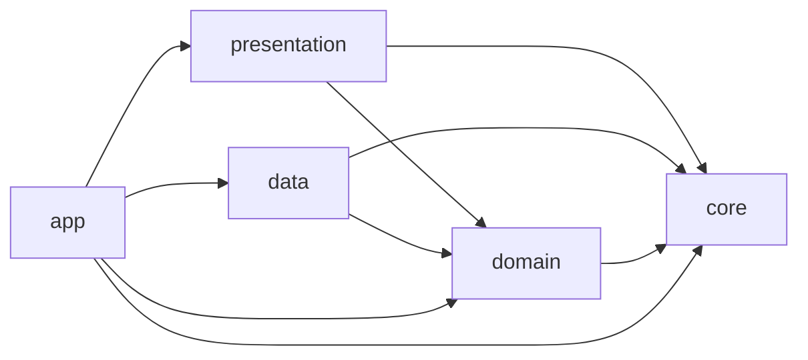
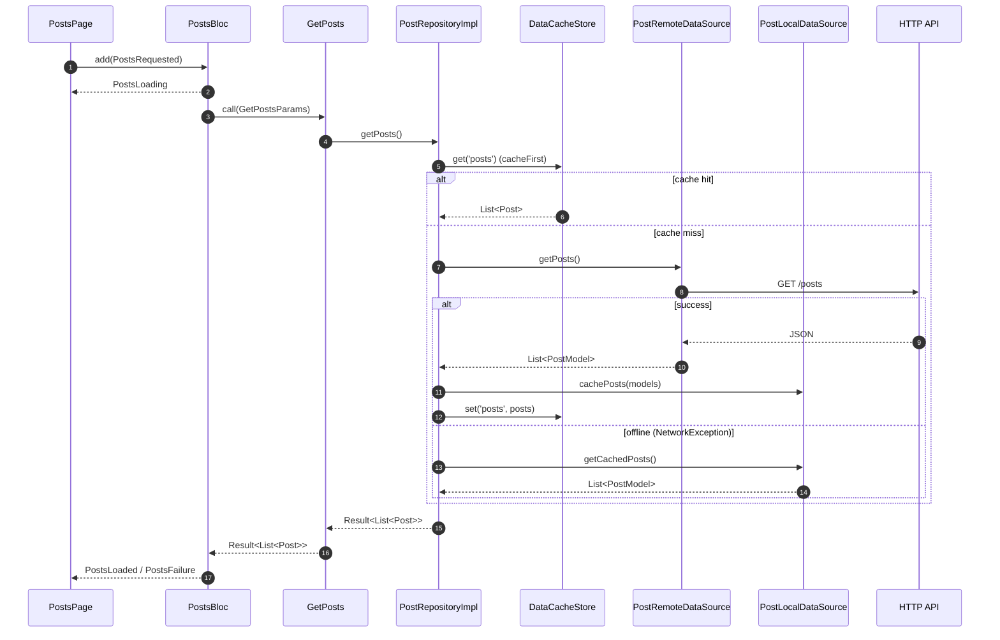

# Architecture

The app follows Clean Architecture with three layers per feature plus two
shared areas (`core`, `app`).

## Layers

| Layer | Contains | May depend on |
|---|---|---|
| **domain** | Entities, repository interfaces, use cases | `core` (pure-Dart parts), `equatable` |
| **data** | Models (DTOs), data sources, repository implementations | domain, `core` |
| **presentation** | Blocs/cubits, pages, widgets | domain, `core` |
| **core** | Feature-agnostic building blocks | nothing in `app/` or `features/` |
| **app** | Composition root: bootstrap, DI, router, flavors, shell | everything |

### The dependency rule

- **domain** has no Flutter, Dio, JSON or DI imports. It describes *what*
  the app does, not *how*.
- **data** implements domain contracts. It knows about HTTP, storage and
  JSON, and converts models to entities (`DomainConvertible.toEntity`).
- **presentation** knows about Flutter and domain. Blocs call **use cases
  only**.
- Features never import other features. Shared needs go to `core/` (or a
  domain contract in `core/`), and cross-feature notifications go through
  the `EventBus`.
- Features never import `app/`. Routes (in `app/router/app_routes.dart`)
  build pages, create their blocs through DI and pass navigation as
  callbacks. This keeps pages testable without the router or GetIt.

### Why `di/` inside each feature?

Use cases live in the domain layer and must not carry `@injectable`
annotations. Each feature therefore has a small `di/<feature>_module.dart`
(`@module`) that registers its use cases. Data and presentation classes
annotate themselves (`@LazySingleton(as: …)`, `@injectable`).

## Request lifecycle

What happens when the posts list opens:

Errors never cross layers as exceptions:

1. Dio throws a `DioException`.
2. The `ErrorMappingInterceptor` and `HttpExceptionMapper` turn it into an `AppException`.
3. `BaseRepository` catches the `AppException` and returns a `FailureResult(Failure)`.
4. The bloc emits a failure state.
5. The UI shows `failure.localizedMessage(l10n)`.

See [error-handling.md](error-handling.md).

## Core building blocks

| Piece | What it gives you |
|---|---|
| `Result<T>` | Success/failure value, exhaustive `switch` |
| `UseCase<T, P>` / `NoParams` | Uniform use case shape |
| `BaseRepository` | `safeCall` (5 `FetchPolicy`s, single-flight, TTL) and `safeWrite` (cache invalidation) |
| `BaseRemoteDataSource` | Dio verbs, error mapping, payload `unwrap` hook |
| `AsyncCubit` + `AsyncBuilder` | Load/retry screens with zero boilerplate |
| `PagingCubit` + `PagingListView` | Cursor pagination with de-duplication |
| `PaginatedCacheMixin` | Cached cursor pages for repositories |
| `EventBus` | Typed app-wide events between features |

## SOLID in practice

- **S** — one use case per action; one public class per file.
- **O** — new behavior = new use case / new `FetchPolicy` / new `Failure`
  subclass, not edits to callers.
- **L** — repository implementations are swappable behind their interface
  (tests use mocks, the integration test uses a fake data source).
- **I** — small interfaces (`NetworkInfo`, `KeyValueStorage`,
  `DataCacheStore`, `ExceptionMapper`).
- **D** — everything depends on abstractions; concrete classes are wired
  only in `app/di`.
